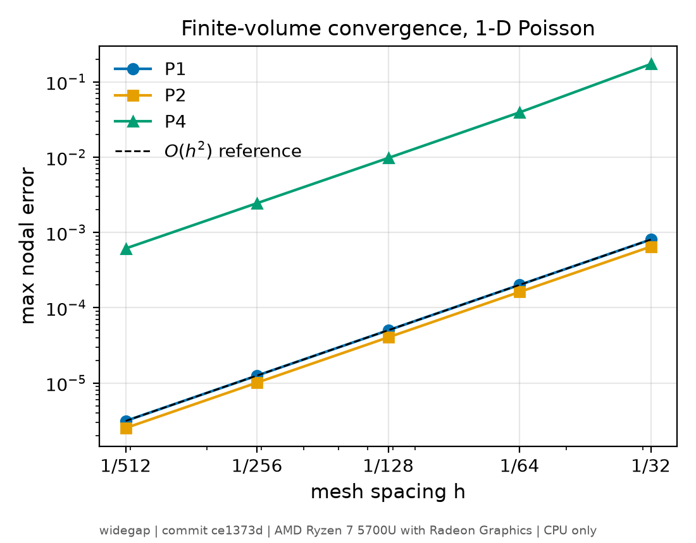
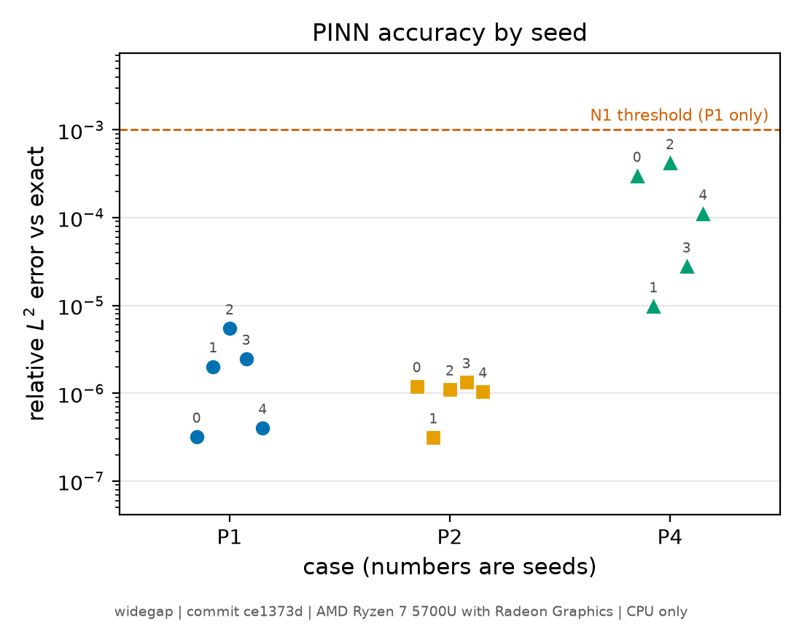

# widegap

Verified finite-volume and physics-informed neural network (PINN) solvers for semiconductor device equations, built in stages toward adjoint doping optimization of wide-bandgap (4H-SiC) power devices. **Verified so far (1D, scaled units, stated model assumptions only): linear Poisson (stage 1), nonlinear equilibrium Poisson for a pn junction (stage 2), steady-state drift-diffusion with Scharfetter-Gummel fluxes (stage 3), and the field-based breakdown index as a numerical quantity (stage 4). There are no SiC material models or device-scale simulations yet.**

## Status

Each stage must pass its own verification gate before the next starts (`docs/literature/requirements_report.md`, section 5).

| Stage | Content | Status |
|---|---|---|
| 1 | Linear Poisson with heterogeneous permittivity (MMS, FV reference, PINN) | verified (gate passed) |
| 2 | Nonlinear equilibrium Poisson, Boltzmann carriers, 1D abrupt pn junction | verified after one failed run and a disclosed re-registered criterion ([result](docs/benchmarks/stage2_result.md)) |
| 3 | Drift-diffusion with Scharfetter-Gummel fluxes (1D, steady state) | verified after one failed run and a disclosed re-registered tolerance ([result](docs/benchmarks/stage3_result.md)); DEVSIM cross-check reported separately |
| 4 | Field-based breakdown-voltage index in 1D (numerical proxy, no impact ionization) | verified after one failed run and a disclosed re-registration against an exact first-integral reference ([result](docs/benchmarks/stage4_result.md)) |
| 5 | Adjoint sensitivities checked against finite differences | not started |
| 6 | 4H-SiC material models (each parameter traced to a primary source) | not started |
| 7 | PINN and SciML stages (surrogates, inverse doping problems) | not started |

## Installation

```bash
python -m venv .venv
source .venv/bin/activate
pip install torch --index-url https://download.pytorch.org/whl/cpu   # optional, CPU-only
pip install -e ".[test]"
```

Python >= 3.10. The package is named `widegap`. torch is optional: the finite-volume reference solver depends only on NumPy and SciPy, and the PINN requires torch (CI runs the test suite and example both with and without torch).

## Minimal example

```bash
python examples/minimal_poisson.py
```

It solves benchmark case P1 with the finite-volume solver and, if torch is installed, a shortened PINN run. It prints the max error of the FV solution and the relative L2 error of the short PINN run (with its training time). Without torch it prints the FV line and a message that the PINN was skipped. These numbers are not the benchmark results below.

## Benchmark results (stage 1)

Problem definitions, error measures and acceptance criteria were fixed before any solver result existed: [docs/benchmarks/poisson_1d.md](docs/benchmarks/poisson_1d.md). One dated amendment (R5 flux balance, restated as R5b/R5c) was also made before any solver output. All quantities are dimensionless.

<!-- results:poisson1d:begin -->
### Finite-volume reference solver (uniform meshes)

Max-norm nodal error against the exact solution (`results/poisson1d/fv.json`):

| Case | N=32 | N=64 | N=128 | N=256 | N=512 | Observed orders |
|---|---|---|---|---|---|---|
| P1 | 8.0e-04 | 2.0e-04 | 5.0e-05 | 1.3e-05 | 3.1e-06 | 2.00, 2.00, 2.00, 2.00 |
| P2 | 6.5e-04 | 1.6e-04 | 4.0e-05 | 1.0e-05 | 2.5e-06 | 2.00, 2.00, 2.00, 2.00 |
| P4 | 1.7e-01 | 3.9e-02 | 9.7e-03 | 2.4e-03 | 6.1e-04 | 2.13, 2.01, 1.99, 2.00 |

- P3 (dielectric interface): max error 5.0e-15 (N=64, interface on a node), 5.3e-14 (N=63, interface inside an element).
- Linear exact solution: max error 5.7e-15.
- R5b discrete flux balance (P1, N=512): relative imbalance 2.1e-13.
- R5c end-element boundary-flux error, N=32..512: 2.5e-03, 6.3e-04, 1.6e-04, 3.9e-05, 9.9e-06; observed orders 2.00, 2.00, 2.00, 2.00.
- FV solve time at N=512: 4.3 ms.

### PINN (3x32 tanh, float64, exact Dirichlet ansatz, Adam then L-BFGS)

Every seed that was run is listed. Relative L2 errors are evaluated on a fixed 2001-point grid.

| Case | Seed | rel. L2 vs exact | rel. L2 vs FV (N=512) | final residual MSE | train time (s) | peak RSS (MiB) |
|---|---|---|---|---|---|---|
| P1 | 0 | 3.2e-07 | 1.6e-06 | 1.6e-08 | 28.2 | 401 |
| P1 | 1 | 2.0e-06 | 3.6e-06 | 9.3e-07 | 26.6 | 402 |
| P1 | 2 | 5.5e-06 | 7.3e-06 | 7.7e-07 | 29.4 | 402 |
| P1 | 3 | 2.5e-06 | 4.1e-06 | 7.5e-07 | 27.7 | 402 |
| P1 | 4 | 4.0e-07 | 2.1e-06 | 4.8e-08 | 29.4 | 402 |
| P2 | 0 | 1.2e-06 | 2.2e-06 | 1.3e-06 | 25.6 | 402 |
| P2 | 1 | 3.1e-07 | 1.7e-06 | 4.2e-08 | 25.8 | 401 |
| P2 | 2 | 1.1e-06 | 2.4e-06 | 5.4e-07 | 26.5 | 403 |
| P2 | 3 | 1.3e-06 | 2.5e-06 | 1.1e-06 | 27.7 | 402 |
| P2 | 4 | 1.0e-06 | 2.1e-06 | 6.5e-07 | 26.2 | 403 |
| P4 | 0 | 3.0e-04 | 3.2e-04 | 1.1e-03 | 26.0 | 401 |
| P4 | 1 | 9.7e-06 | 1.2e-04 | 5.7e-05 | 26.9 | 401 |
| P4 | 2 | 4.2e-04 | 4.3e-04 | 1.6e-03 | 26.8 | 401 |
| P4 | 3 | 2.8e-05 | 1.2e-04 | 1.1e-04 | 27.4 | 401 |
| P4 | 4 | 1.1e-04 | 1.6e-04 | 1.5e-03 | 26.8 | 401 |

**Gate:** passed (R1_P1 pass, R1_P2 pass, R2 pass, R3 pass, R4 pass, R5_linear pass, R5b pass, N1 pass). Pre-registered configuration: True.

Provenance: commit `ce1373d` (clean tree: True), AMD Ryzen 7 5700U with Radeon Graphics, 8 torch threads, CPU only, torch 2.14.1+cpu, NumPy 2.5.4, SciPy 1.18.1, run at 2026-10-21T04:38:06 UTC.
<!-- results:poisson1d:end -->

Reading the tables:

- The "vs FV" column is dominated by the FV solution's own error (about 3e-6 for P1 at N=512), so it is larger than the "vs exact" column. The two comparisons agree to within that level, as pre-registered (N2).
- P4 (steep layer) is a stress test and does not gate. Its PINN error varies by more than an order of magnitude across seeds.
- Cost-to-accuracy: on P1 the PINN needs about 25 s of training to reach the error that the FV solver reaches in milliseconds. The gate shows the PINN code is correct, not that it is competitive.
- Repeated runs of the same configuration on this machine and build gave bit-identical PINN errors. This is not a cross-platform determinism claim.

Figures are generated from the same JSON (`python benchmarks/poisson1d/make_figures.py`):




Reproduce everything:

```bash
python benchmarks/poisson1d/run.py --out results/poisson1d
python benchmarks/poisson1d/make_figures.py
python benchmarks/poisson1d/report.py   # rewrites the tables above from the JSON
```

## Supported features

- 1D vertex-centred (box-method) finite-volume solver for $-(\varepsilon u')' = f$ with Dirichlet conditions, length-weighted harmonic-mean element permittivity, banded direct solve.
- 1D PINN for the same equation: strong-form residual loss via automatic differentiation, Dirichlet conditions imposed exactly by construction.
- Manufactured-solution problems P1 to P4 and error measures (max error, relative L2, observed order).
- Reproducible benchmark runner that writes per-case and per-seed JSON and a manifest.

## Limitations

- 1D only. No field-dependent mobility, impact ionization, breakdown, or adjoint machinery yet.
- No 4H-SiC parameters and no physical units; permittivity contrast and all values are dimensionless.
- PINN timings are CPU-only and were measured on one machine.
- The PINN error on the steep layer P4 varies by about 40x across seeds.
- Stages 2, 3 and 4 each failed their first run on a pre-registered criterion that was itself flawed (stages 2-3: below the round-off floor; stage 4: depletion-approximation references inadequate at ~100 V_T); each passed after a re-registered criterion disclosed as written after the failure.
- The field-based breakdown voltage is a proxy: no impact ionization is modelled, and E_crit is a study constant, not a material value.
- Stages 2-3 are verified only for n_i/N0 >= 1e-8 (stage 2) and 1e-3 (stage 3); 4H-SiC-realistic n_i/N0 ~ 1e-25 is not supported.

## Scientific attribution

The method context comes from the following works. **No published device result is reproduced.**

- C. Zhu, P. Andrei, AIP Advances 9, 095301 (2019), [doi:10.1063/1.5113764](https://doi.org/10.1063/1.5113764): adjoint doping-sensitivity method and field-based breakdown index (silicon IGBT).
- P. Brungi, P. Andrei, AIP Advances 16, 035014 (2026), [doi:10.1063/5.0320204](https://doi.org/10.1063/5.0320204): 4H-SiC MOSFET context and comparison targets.
- M. Raissi, P. Perdikaris, G. E. Karniadakis, J. Comput. Phys. 378, 686-707 (2019), [doi:10.1016/j.jcp.2018.10.045](https://doi.org/10.1016/j.jcp.2018.10.045): PINNs.
- P. J. Roache, J. Fluids Eng. 124, 4-10 (2002), [doi:10.1115/1.1436090](https://doi.org/10.1115/1.1436090): method of manufactured solutions.

Classification of this project's work (`docs/literature/requirements_report.md`, section 4):

- *Reproduction*: none claimed. Both device-level optimization studies cannot be reproduced from the published information (missing supplementary material, model parameters, meshes and impact-ionization coefficients).
- *Independent implementation inspired by published work*: the adjoint doping-sensitivity method and the field-based BV index are planned (stages 4 and 5); neither is implemented yet.
- *New contribution*: none yet. PINN and hybrid solvers for these equations remain unverified hypotheses until benchmarked.

This project is not affiliated with and has not been endorsed by the cited authors.

## Tests

```bash
pytest
```

- R1: P1 and P2 observed max-norm orders in [1.9, 2.1].
- R2, R3: max-error thresholds for P1 and P2 at N=512.
- R4: P3 reproduced to round-off with the interface on a node and inside an element.
- R5: a linear solution is reproduced to round-off.
- R5b: discrete flux balance holds to round-off (P1, N=512).
- N1: PINN on P1 reaches rel. L2 error of at most 1e-3 against the exact solution for all five seeds.

The R1 to R5b checks run on the reference solver; the full N1 check is part of the benchmark runner.

## Documentation

- [Project specification v2 (stages, gates, rules)](docs/PROJECT_SPEC.md)
- [Benchmark P1-P4 pre-registration and amendment](docs/benchmarks/poisson_1d.md)
- [Literature and requirements report](docs/literature/requirements_report.md)
- [Raw results and manifest](results/poisson1d/)

## Contributing

See [CONTRIBUTING.md](CONTRIBUTING.md) and the [Code of Conduct](CODE_OF_CONDUCT.md).

## Citation

See [CITATION.cff](CITATION.cff). Please also cite the original works for the methods used.

## License

Apache License 2.0, see [LICENSE](LICENSE). Cited papers are the property of their authors and publishers and are not redistributed here.
